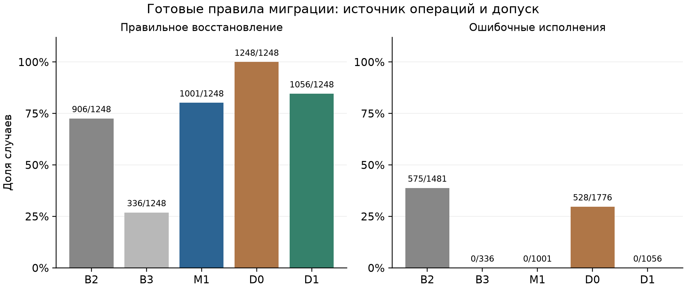
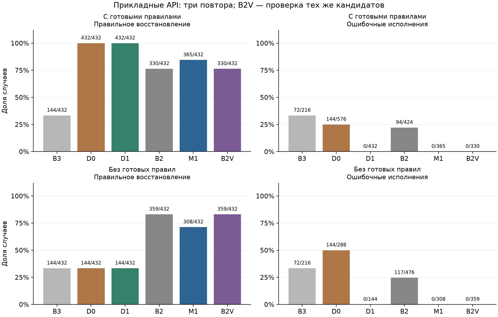

# Проверяемое восстановление вызовов MCP при изменении контрактов: вклад правил миграции и семантического допуска

Россинский Андрей Евгеньевич

Франкфурт. Организация: [указать при наличии]. Контакт: dennrbone@gmail.com.

Научная рукопись для авторской проверки. Конкретный журнал не выбран;
редакционные требования и решение о подаче в эту версию не входят.

## Аннотация

Исследуется восстановление вызовов инструментов Model Context Protocol после
изменения контрактов. В прототипе mcp-compat источник операций миграции отделён
от допуска к исполнению: проверяются схема и наблюдаемое поведение доверенных
старой и новой реализаций, при недостатке оснований выдаётся отказ. Исходный
опыт включает 2160 сценариев и 19440 решений девяти методов с GigaCode CodeAgent;
проверяемый гибрид M1 восстановил 1001/1248 допустимых случаев при нуле
наблюдавшихся ошибочных исполнений. Детерминированный контроль готовых операций
D1 восстановил 1056/1248 случаев без модели. Дополнительная прикладная проверка
содержит 192 сценария, два условия информации и три повтора — 5760 решений.
С готовыми правилами D1 восстановил 432/432 случая, M1 — 365/432. Без готовых
операций M1 восстановил 308/432, а производный контроль тех же кандидатов B2
с независимой проверкой — 359/432; у обоих нулевой наблюдаемый Unsafe Healing Rate.
Контроли меняют интерпретацию вклада: необходимость модели при готовых правилах
и превосходство полного гибрида не подтверждаются. Используются кластерные
интервалы и анализ ложных отказов. Локальные API, один непрозрачный модельный
alias и нарушения доступности сервиса ограничивают обобщение; универсальная
безопасность не доказана.

Ключевые слова: Model Context Protocol; эволюция API; совместимость контрактов;
восстановление вызовов; семантическая проверка; отказ от исполнения; CodeAgent.

## 1. Введение

Автоматизированный процесс может перестать работать после переименования
параметра, изменения вложенности или кодирования значения. Повторная отправка
старого запроса не устраняет несовместимость. При этом синтаксически допустимый
запрос способен изменить другое состояние: проверка схемы ещё не означает
сохранения поведения.

Цель работы — исследовать восстановление конкретного вызова между известными
версиями инструмента с отказом при недостаточной проверяемости. Практическое
назначение — сохранить интеграцию после обновления API и сократить риск
автоматического исполнения ошибочной миграции. Разработчик предоставляет
доверенные реализации для предварительного сравнения. Если этого сделать
нельзя, прототип не обещает восстановить семантику из одной схемы.

Исследовательские вопросы: как меняется соотношение восстановления и ошибочного
исполнения при независимой проверке; какую часть результата дают готовые
правила вместо генератора; что происходит без готовых операций; какие
допустимые случаи теряются из-за ограничений допуска. Последний вопрос
существенен: постоянный отказ не допускает ошибочных исполнений, но не решает
задачу восстановления.

## 2. Связанные работы и вклад

Сопоставление схем, сохранение поведения при изменении API и дифференциальное
тестирование — предшествующие направления. Контролируемый перенос полей и
сравнение результатов сами по себе не составляют новизну этого исследования.
[Rahm, Bernstein, 2001](https://link.springer.com/article/10.1007/s007780100057),
[Dig, Johnson, 2006](https://dig.cs.illinois.edu/papers/JSME_API_Evolution.pdf),
[McKeeman, 1998](https://www.cs.tufts.edu/comp/150FP/archive/bill-mckeeman/DifferentailTesting.pdf).

Эволюция MCP уже исследуется в MCPEvol-Bench, где оценивается выполнение задач
агентами при изменении серверов. Поэтому первое исследование эволюции MCP
не заявляется. Здесь единица оценки — отдельный старый вызов и решение о
миграции, а не полный многошаговый процесс.
[Liu и соавт., 2026](https://arxiv.org/html/2607.14642v1).

ToolDriftBench рассматривает устаревание индекса инструментов и частичное
переиндексирование. В нашей работе пара контрактов предполагается известной;
поиск инструмента и актуализация каталога не решаются. Сопоставление ограничено
официальной аннотацией IEEE; полный текст через используемый доступ недоступен.
[IEEE SmartIoT, 2026](https://ieeexplore.ieee.org/abstract/document/11677805/).

Gecko уточняет вызовы в симуляции до исполнения. Сам принцип предварительной
проверки также не нов. Отличие рассматриваемого прототипа — сравнение старого
и нового доверенных обработчиков для конкретного вызова без модели,
генерирующей результат проверки.
[Zhang и соавт., 2026](https://arxiv.org/html/2602.19218v2).

TOOLVERIFIER использует самопроверку модели; здесь предложение и программный
допуск разделены. ToolSandbox и τ-bench учитывают состояние и повторяемость.
JSONSchemaBench исследует структурированную генерацию, которая здесь служит
только первым уровнем корректности. VerifierBench показывает, почему вместе
с ошибочными допусками следует измерять отбрасывание правильных решений.
[Mekala и соавт., 2024](https://arxiv.org/abs/2402.14158v2),
[Lu и соавт., 2025](https://arxiv.org/abs/2408.04682v2),
[Yao и соавт., 2024](https://arxiv.org/abs/2406.12045v1),
[Geng и соавт., 2025](https://arxiv.org/abs/2501.10868v3),
[Yin и соавт., 2026](https://arxiv.org/abs/2610.28679v1).

Вклад сформулирован как воспроизводимое экспериментальное разделение источника
миграционных операций и проверки допуска. Превосходство над всеми существующими
методами не заявляется. Поиск и границы доступа описаны в LITERATURE_REVIEW.md.

## 3. Постановка задачи

Контракт C включает имя, описание, входную и выходную схемы и разрешённые
метаданные. Известны C₀, C₁ и старый допустимый вызов x. Мигратор выдаёт либо
EXECUTE с новым вызовом a(x), либо ABSTAIN. Идентификатор сценария, метка
восстанавливаемости и эталонный ответ мигратору не передаются.

Пусть F₀(x,s) и F₁(a(x),s) — исполнение версий на одинаковом начальном состоянии
s. Для чистого инструмента наблюдение O — нормализованный результат, для
инструмента с побочными эффектами — конечное состояние. Проверяется условие
O(F₀(x,s)) = O(F₁(a(x),s)). Это равенство для одного входа и состояния, а не
эквивалентность функций для всех входов. При сравнении состояния возвращаемое
подтверждение отдельно не сравнивается.

Сценарии относятся к SAFE_AUTO, CONDITIONAL или MUST_ABSTAIN. Отдельная метка
допустимого восстановления определяет знаменатель CRR. Восемь семейств изменений
охватывают имена, необязательные и обязательные параметры, удаление, типы, enum,
вложенность и семантические изменения. Составные случаи учитываются один раз
по основной семье; категории и семьи не смешиваются.

**Условное утверждение о допуске.** Если обработчики доверены, наблюдения полны,
исполнение происходит на независимых копиях одного s и завершается, то
положительная проверка устанавливает равенство выбранных наблюдений в этой
проверке. Утверждение непосредственно следует из их сравнения. Для переноса
вывода на последующее исполнение нужны те же реализации и релевантное
состояние, отсутствие неучтённых внешних эффектов и недетерминизма. Прототип
не доказывает эти предпосылки автоматически.

## 4. Метод и реализация

Сначала проверяются старый вызов и структурная разница. Консервативные правила
предлагают поддерживаемые преобразования. Если кандидата нет, проверяется
неизменённый набор аргументов с новым именем инструмента. Успешное независимое
сравнение позволяет использовать такой кандидат без генератора. В остальных
случаях генератор предлагает ограниченные операции.

Допустимы move, set, string, wrap, enum и scale. Модель не создаёт исполняемый
Python. Ответ проходит строгий разбор единственного JSON-объекта и проверку
операндов; принимается также один полный блок JSON без окружающего текста.
Произвольный фрагмент из пояснения не извлекается. Ограничены размеры запроса,
ответа и число операций. Проверяются новая схема, поведение версий и
доказуемость литералов и единиц. Ошибка, неизвестная привязка или отрицательная
проверка дают ABSTAIN.

Привязка обработчиков использует хеши полных контрактов. В исходном наборе
разные кодировки иногда имеют одинаковую сигнатуру, поэтому 192 допустимых
случая остаются без однозначной привязки. Верификатор не подменяет её эталоном
оценщика. Копирование изолирует только зарегистрированное локальное состояние.
Это не операционная песочница: таймер обнаруживает превышение после возврата
функции и не прерывает произвольный зависший обработчик.

MCP proxy принимает старую форму, получает решение и передаёт допущенный новый
вызов upstream-серверу. Возвращаемый объект проверяется по старому контракту.
Универсальное преобразование изменившихся выходных схем не реализовано.
Интерфейс LLMClient и стандартный MCP transport допускают подключение другого
поставщика через адаптер; исследован только установленный GigaCode CodeAgent.

## 5. Методика

### 5.1. Исходный набор

Набор evobench-1.2, seed 42: 48 упрощённых инструментов, восемь областей,
1920 базовых и 240 составных сценариев. Digest:
`ef002e38917804b246bdd0d9a5c104160f89b76a4f15de34499c5dcb2b2ce8de`.
Повторяются 40 шаблонов мутаций; строки не являются независимыми приложениями.
Исходный опыт: один полный повтор, девять методов, восемь workers.

B0 повторяет старый вызов; B1 предлагает вызов с ограниченным контекстом; B2
использует оба контракта без независимого допуска; B3 содержит структурные
правила. M1 — полный метод. A1 исключает верификацию, A2 структурный этап,
A3 генератор, A4 ограничения риска. Исходные данные не являются
непросмотренной контрольной выборкой после разработки и анализа.

Модель: alias gigacode/GigaCode, CodeAgent, CLI 26.10.76, mapping-2.0,
temperature=0, max_tokens=2048, до двух попыток в бюджете 120 секунд. Среда:
Python 3.11.4, macOS 27.0 arm64. Серверная ревизия, квантование и оборудование
модели неизвестны. Seed фиксирует данные и анализ, но не детерминированность
сервиса. Исходный код опыта: 7fc2627e.

### 5.2. Контроль источника операций

После исходного опыта добавлены D0/D1. D0 исполняет публичные операции с
проверкой схемы. D1 сохраняет допуск M1, получая операции напрямую. Контроли
дают 4320 решений без модели. Они проверяют влияние переданного знания:
значительная часть context.rules уже содержит готовый адаптер. Общие модули
восстановления и оценки совпадают с Phase 16; сравнение скорости запусков
при разных нагрузках не проводится.

### 5.3. Прикладная проверка

Протокол 1.4 до ответов модели фиксирует 12 новых локальных API в шести
областях, по два входа и восемь изменений — 192 сценария. Первые шесть
изменений восстанавливаемы, последние два требуют отказа. Эталоны заданы
вручную отдельно от обработчиков. Версии API используют общий прикладной
расчёт и разные декодеры; это не серверы независимых внешних разработчиков.

Созданы два условия: операции миграции переданы и готовые операции отсутствуют.
Контракты, вызовы и закрытые эталоны внутри пары одинаковы. Методы B3/D0/D1/B2/M1,
три полных повтора, четыре workers: 5760 решений. Данные и код зафиксированы
коммитом fda30006. Локальная машина в ходе опыта: Apple M4, 10 логических
CPU, 16 ГиБ памяти; серверное оборудование модели неизвестно. Разметка проверена до ответов модели, подбора генератора
по новым результатам нет. Проверка остаётся авторской локальной моделью API,
а не независимым внешним исследованием.

В запуске зафиксировано прерывание после 1118 сохранённых решений при
повторяющихся ProviderError и сетевом HTTP 503. После восстановления связи
прогон продолжен с тем же fingerprint, без замены ошибочных ответов. Неизвестное
использование запросов в работе при остановке отмечено отдельно. Оба условия и все три повтора завершены: 5760 решений проверены по хешам,
полноте матриц, меткам, разрешённым входам и независимым исходам. Ошибки
провайдера включены в показатели, а диагностические пробы учитываются отдельно.

### 5.4. Показатели и анализ

CRR — правильные исполнения допустимых случаев / допустимые случаи.
UHR — исполнения с неэквивалентным наблюдением / все исполнения.
Ошибка локального исполнения также считается неэквивалентным исходом;
показатель не ограничен только незаметным изменением корректного результата.
FBR — отказы среди допустимых случаев / допустимые случаи.
Отдельно измеряется доля обязательных отказов. Нулевой знаменатель даёт
неопределённый показатель; ошибочное исполнение не считается ложным отказом.
Неизвестные токены и стоимость остаются null.

Используются 2000 bootstrap-выборок целых инструментов, seed 42, с сохранением
всех сценариев и повторов внутри кластера. Дополнительно группируется по
областям. Это учитывает зависимость внутри инструмента, но не устраняет общность
шаблонов между ними. Число и независимость групп ограничивают интерпретацию.
[Cameron, Miller, 2015](https://cameron.econ.ucdavis.edu/research/Cameron_Miller_JHR_2015_February.pdf).

Перестановка меняет знак целого кластерного контраста; её нулевая модель
предполагает обменность меток методов в кластере. До 16 ненулевых кластеров
перебираются все комбинации, далее — 9999 перестановок с поправкой +1.
Сценарный McNemar диагностический; Wilcoxon не применяется без подтверждения
симметрии. P-значения дополнительных сравнений разведочные, без подтверждения
совокупности гипотез. Повторы не увеличивают число независимых инструментов.

## 6. Завершённые результаты

Таблица 1. Исходный прогон и дополнительные контроли. Знаменатель CRR — 1248,
знаменатель обязательного отказа — 912.

| Метод | Правильное восстановление | Ошибочные исполнения | Обязательный отказ |
|---|---:|---:|---:|
| B0 | 384 (30,8%) | 480/864 | 528 |
| B1 | 799 (64,0%) | 769/1568 | 361 |
| B2 | 906 (72,6%) | 575/1481 | 434 |
| B3 | 336 (26,9%) | 0/336 | 912 |
| M1 | 1001 (80,2%) | 0/1001 | 912 |
| A1 | 908 (72,8%) | 16/924 | 896 |
| A2 | 589 (47,2%) | 0/589 | 912 |
| A3 | 432 (34,6%) | 0/432 | 912 |
| A4 | 1127 (90,3%) | 33/1162 | 879 |
| D0, дополнительно | 1248 (100%) | 528/1776 | 384 |
| D1, дополнительно | 1056 (84,6%) | 0/1056 | 912 |

Рисунок 1. Наблюдаемые доли и их числители/знаменатели. Показаны точечные
оценки; интервалы CRR обсуждаются в тексте. Нули UHR не являются границей риска.

Для M1 кластерный интервал CRR — 78,77–81,49%. Из 247 ложных отказов 192
относятся к неоднозначным сигнатурам, ещё 55 — к поддерживаемым случаям:
36 непригодных ответов, 17 распознанных отказов модели, два недоказанных
литерала. Поддерживаемое подмножество даёт 1001/1056 (94,8%), но не заменяет
основную долю 1001/1248. В C5 восстановлено 0/144: общее среднее скрывает
пробел в преобразованиях типов.

При готовых правилах D1 превосходит M1 на 55 правильных восстановлений.
Разность M1−D1 — −4,41 п.п., кластерный 95% ДИ от −5,85 до −3,13 п.п.
Разведочное p по инструментам — 0,0001, по восьми областям — 0,0078125.
Этот результат не поддерживает необходимость модельной генерации в данном
условии. Сравнение D0/D1 показывает цену допуска: потеряны 192 допустимых
восстановления и заблокированы 528 ошибочных исполнений D0.

Повторная проверка тех же кандидатов B2 отдельным верификатором (B2V)
сохранила 820 правильных исполнений из 1248 допустимых случаев, UHR 0/820 и
912/912 обязательных отказов. Заблокированы все 575 ошибочных исполнений
исходного B2 и ещё 86 правильных кандидатов без однозначной runtime-привязки.
Дополнительных запросов к модели не было; 2303 исходных CLI-вызова B2
не учитываются повторно как физические запросы. Это контроль только
верификатора, без структурных кандидатов и полного ограничения риска M1.

Исходный прогон содержит 10896 модельных решений, 11731 CLI-вызов и 10303
распознанных итоговых предложения; 593 решения закончились без пригодного
предложения. Ошибки провайдера и конвейера сохранены. Неизвестное использование
не заменено нулём; нулевая стоимость в ответах не является аудитом тарификации.

### Прикладная проверка: завершённое условие с готовыми правилами

Таблица 2. По 576 решений на метод, 432 допустимых восстановления и 144
обязательных отказа. Это три повтора 192 сценариев, а не 576 независимых API.
B2V — производный контроль тех же кандидатов B2, без новой генерации.

| Метод | Правильное восстановление | Ошибочные исполнения | Обязательный отказ |
|---|---:|---:|---:|
| B3 | 144/432 (33,3%) | 72/216 | 72/144 |
| D0 | 432/432 (100%) | 144/576 | 0/144 |
| D1 | 432/432 (100%) | 0/432 | 144/144 |
| B2 | 330/432 (76,4%) | 94/424 | 50/144 |
| M1 | 365/432 (84,5%) | 0/365 | 144/144 |
| B2V, проверка B2 | 330/432 (76,4%) | 0/330 | 144/144 |

В M1 67 ложных отказов: 61 без пригодного предложения провайдера, один
таймаут, один распознанный отказ модели и четыре недоказанных литерала.
Однозначные привязки нового набора устраняют исходный фактор 192 неподдерживаемых
сигнатур; это не исправление задним числом старого набора и не основание
сравнивать проценты двух разных наборов как прогресс одного метода.

Разность M1−D1 равна −15,51 п.п., кластерный 95% ДИ по 12 инструментам
от −21,30 до −9,72 п.п. Точная перестановка знаков кластерных контрастов даёт p=0,00390625,
но группировка по шести областям — p=0,0625. Последний результат и общность
шаблонов ограничивают вывод о статистической устойчивости. Сетевые нарушения
также создают зависимость между измерениями разных инструментов. Подтверждающий
вывод о превосходстве архитектуры по этим p-значениям не делается.

M1 восстанавливает 113/144, 125/144 и 127/144 случаев по трём повторам;
B2 — 93/144, 119/144 и 118/144. Все три раза правильно восстановлены
85 из 144 уникальных допустимых случаев у M1 и 55 у B2. Эта вариативность
включает состояние сервиса, а не только различия собственно генерации.

B3 допускает структурно подходящие вызовы при скрытом изменении наблюдаемого
поведения. В новом наборе нулевого UHR у него нет. D1 блокирует такие случаи
при сохранении всех допустимых восстановлений с готовыми операциями. Контроль
B2V сохраняет все 330 правильных кандидатов B2 и блокирует 94 неверных.

### Прикладная проверка без готовых операций

Таблица 3. Те же 192 сценария и три повтора. Знаменатели CRR и обязательного
отказа остаются 432 и 144. Готовых операций нет, но доверенные обработчики
для проверки доступны M1, D1 и производному контролю B2V.

| Метод | Правильное восстановление | Ошибочные исполнения | Обязательный отказ |
|---|---:|---:|---:|
| B3 | 144/432 (33,3%) | 72/216 | 72/144 |
| D0 | 144/432 (33,3%) | 144/288 | 0/144 |
| D1 | 144/432 (33,3%) | 0/144 | 144/144 |
| B2 | 359/432 (83,1%) | 117/476 | 27/144 |
| M1 | 308/432 (71,3%) | 0/308 | 144/144 |
| B2V, проверка B2 | 359/432 (83,1%) | 0/359 | 144/144 |

Рисунок 2. Наблюдаемые доли с числителями и знаменателями. B2V — последующая
проверка уже сохранённых кандидатов, без новых модельных запросов; график
не представляет дополнительный независимый запуск генератора.

M1 превосходит ограниченный D1 по CRR на 37,96 п.п.: кластерный 95% ДИ
34,95–41,44 п.п., p по инструментам 0,00048828125, по областям 0,03125.
Однако M1 уступает B2V на 51 восстановление, или 11,81 п.п.; ДИ разности
M1−B2V от −18,06 до −5,09 п.п., p по инструментам 0,01318, по областям 0,0625.
Это разведочные сравнения при оговорённых предпосылках, без поправки на
множественность. Они не доказывают превосходства над всеми алгоритмами
детерминированного поиска миграции.

У M1 124 ложных отказа: 53 отказа при применении некорректных модельных
операций, 40 недоказанных литералов, 31 отказ/непригодное предложение.
Повторное применение сохранённых операций без новых запросов выявляет во всём
условии 52 обращения через скалярные исходные значения и два пересечения
целевых путей; один из этих 54 случаев относится к обязательному отказу.
Формальная схема ответа ограничивает форму пути, но не гарантирует его
разрешимость в исходных данных. Эти операции отклонены, а не исполнены.
Литералы отклонялись в C5 (26) и C6 (14), даже когда предварительное сравнение
было положительным: полная политика M1 строже одного сравнения исходов.

По трём повторам M1 восстановил 103/144, 103/144 и 102/144 случаев;
B2 — 116/144, 120/144 и 123/144. Все три раза правильно восстановлены
83/144 уникальных случаев у M1 и 104/144 у B2/B2V. B2V сохранил все
359 правильных кандидатов B2 и заблокировал 117 неверных. Он является
контролем верификатора, не содержит всей политики риска M1 и не испытан
как отдельная продукционная стратегия с повторным планированием.

Для всего прикладного опыта записано 2126 CLI-обращений в трассах решений,
468 ошибок попыток ProviderError и одна ValueError. Полный учёт обращений
в работе при прерывании неизвестен. Значения стоимости/токенов с неполным
учётом остаются null. Задержка B2V в производных данных — сумма времени
генерации и позднейшей проверки, а не наблюдавшееся сквозное время новой системы;
для выводов о скорости она не используется.

### Статус исходных гипотез

H1: в исходном наборе M1 имеет больше правильных восстановлений, чем B0/B3;
обобщение за пределы этого набора и подтверждающий множественный анализ не
выполнены. D1 меняет интерпретацию результата: модель не является необходимым
источником наблюдаемого преимущества при готовых операциях.

H2: наблюдаемое число ошибочных исполнений ниже, чем у B2. Контроль тех же
кандидатов B2V показывает действие фильтра без повторной генерации, но не
устанавливает универсальную границу риска.

H3: не проверена, поскольку исследован только CodeAgent. Переносимый программный
интерфейс не заменяет опыт с другим семейством моделей.

H4: абляции сохранены, однако разные последовательности ответов и изменение
доступности предварительного кандидата не позволяют приписать всю разность
одному заключительному фильтру. Преимущество в заданной формулировке не считается
доказанным. Контроль B2V оценивает более узкое вмешательство на тех же кандидатах.

## 7. Инженерная проверка и воспроизводимость

Phase 17: 311 тестов прошли в исходниках и отдельно установленном wheel,
пять проверок провайдера отключены, покрытие строк и ветвей 100%. Перед новым
прогоном локально прошли 315 тестов при том же покрытии. Финальная версия
прошла 325 тестов без пропусков, включая шесть реальных проверок CodeAgent;
отдельно установленный wheel — 319 тестов и шесть отключённых provider-тестов.
В обоих случаях покрытие пакета — 100% строк и ветвей. Через официальный
MCP SDK проверены 192 прикладных сценария: допустимые вызовы сохраняют
результат/состояние, обязательные отказы не исполняют upstream-вызов.
Эти инженерные проверки не заменяют оценку качества модели. Массовый runner
вызывает стратегии напрямую; протокольный обмен проверяется отдельно. Число
решений в таблицах не выдаётся за число запросов через MCP transport.

Данные, manifests, хеши решений и исходников хранятся в приватном репозитории
автора `dennrbone/mcp-compat`. Анонимный доступ не открыт; способ доступа
внешним рецензентам определяется автором при подаче. Лицензия распространения
в репозитории пока не указана. Эти сведения не заменяются обещанием открытого
доступа. Исходный
набор и результаты не перезаписаны после дополнительного анализа. Разные
условия и версии имеют отдельные каталоги. Команды повторения приведены в
приложении к исследованию. Ошибки, неизвестное использование и неполное
покрытие реализациями остаются в отчёте. CI проверяется по SHA отдельно от
локальных тестов и эксперимента с сервисом. После сбора данных устранён
отдельный дефект D0 при некорректном пути через скаляр: вместо AttributeError
возвращается отказ. Регрессионный тест до исправления не прошёл, после прошёл;
1152 сохранённых решения D0 не изменились. Этот патч не применялся во время
эксперимента, который остаётся связанным с fda30006 и исходным fingerprint.

## 8. Ограничения

Приложения упрощены, шаблоны повторяются, новый набор подготовлен тем же
автором. Внешние серверы, конкурирующие алгоритмы поиска миграций и многошаговые
задачи не проверены. В новом наборе вариант изменения результата имеет
систематический суффикс имени `_revised`; названия могут давать генератору
дополнительные подсказки. Не исследована устойчивость к обезличиванию имён.
Семантический негативный контроль добавляет наблюдаемый audit-компонент к
результату или состоянию. Это искусственное нарушение выбранного равенства;
при другом наборе наблюдаемых свойств такое изменение может считаться допустимым. Результаты не распространяются на более широкий класс
реальных задач, представленный, например, MCP-Atlas.
[Bandi и соавт., 2026](https://arxiv.org/abs/2602.00933v3).

Нулевой UHR не доказывает нулевого риска; bootstrap при нуле ошибок способен
дать вырожденный интервал. Число независимых реализаций существенно меньше
числа решений. Требования к обработчикам, завершению и полноте состояния
могут не выполняться в production. Состояние способно измениться между
проверкой и исполнением. Внешние эффекты, скрытые зависимости, недетерминизм
и враждебный код не охвачены.

Исследован один непрозрачный alias. Повторы оценивают вариативность сервиса,
но не устойчивость к смене семейства моделей. Исходная гипотеза нескольких
семейств остаётся непроверенной: по условию используется только CodeAgent.
Стоимость ручной подготовки доверенных обработчиков и полного наблюдаемого
состояния не измерялась. Нулевое число модельных запросов D1 не означает
нулевой стоимости внедрения; при наличии таких знаний ручная миграция может
оказаться проще. Задержка CLI включает запуск клиента и сетевой обмен, а
чистое время генерации отдельно не измерено.

Квота и нагрузка сервиса также могут влиять на наблюдения. Условия нового
опыта запускаются последовательно, поэтому различия между ними могут
зависеть и от времени обращения к сервису, а не только от наличия правил.
Порядок сценариев и методов также фиксирован. Во время второго условия
на том же Mac выполнялся анализ первого; сравнение задержек как причинного
эффекта доступности правил не проводится.

Актуальная спецификация MCP — 2026-07-28 с изменённым протокольным ядром.
Прототип закреплён на SDK 1.30.0 и протоколе 2025-11-25; соответствие всем
возможностям новой редакции не исследовано. Это отдельное ограничение версии
протокола, а не изменение исследуемых прикладных контрактов.
[Официальное объявление MCP](https://blog.modelcontextprotocol.io/posts/2026-07-28/).

## 9. Заключение

Реализовано разделение предложения миграции, проверки схемы и сравнения
наблюдаемого поведения. Готовые операции с независимым допуском восстанавливают
больше случаев, чем модельный гибрид, без обращений к генератору. При отсутствии
готовых операций M1 расширяет покрытие относительно ограниченных правил,
но уступает последующей проверке полных кандидатов B2. Поэтому вклад проверки
и сложность генератора следует оценивать раздельно; полный гибрид не следует
считать предпочтительным только по архитектуре.

Практическое значение работы — воспроизводимый способ измерять восстановление
вместе с ценой ложных отказов и ошибочными допусками. Нулевой наблюдаемый UHR
не устанавливает универсальной безопасности. Следующий исследовательский шаг —
проверка разрешимости модельных путей и политика генерации с сохранением
ограничений риска на независимых внешних API; в этой работе такие новые
улучшения не объявляются испытанными.

## Литература

1. Liu H., Hu K., Liao J. и др. MCPEvol-Bench: Benchmarking LLM Agent Performance
Across Dynamic Evolutions of MCP Servers. 2026. arXiv:2607.14642v1.
[Первичный текст](https://arxiv.org/html/2607.14642v1).
2. ToolDriftBench: Detecting and Recovering from MCP Tool Index Staleness in
Agentic Systems. IEEE SmartIoT, 2026. DOI: 10.1109/SmartIoT70864.2026.00056.
[Страница издателя](https://ieeexplore.ieee.org/abstract/document/11677805/).
3. Zhang Z., Li G., Xing Z., Apostolopoulos A., Lee Y. L., Zheng L.
Gecko: A Simulation Environment with Stateful Feedback for Refining Agent Tool
Calls. 2026. arXiv:2602.19218v2. [Первичный текст](https://arxiv.org/html/2602.19218v2).
4. Mekala D., Weston J., Lanchantin J. и др. TOOLVERIFIER: Generalization to New
Tools via Self-Verification. 2024. arXiv:2402.14158v2.
[Первичная страница](https://arxiv.org/abs/2402.14158v2).
5. Lu J., Holleis T., Zhang Y. и др. ToolSandbox: A Stateful, Conversational,
Interactive Evaluation Benchmark for LLM Tool Use Capabilities. 2025.
arXiv:2408.04682v2. [Первичная страница](https://arxiv.org/abs/2408.04682v2).
6. Yao S., Shinn N., Razavi P., Narasimhan K. τ-bench: A Benchmark for
Tool-Agent-User Interaction in Real-World Domains. 2024. arXiv:2406.12045v1.
[Первичная страница](https://arxiv.org/abs/2406.12045v1).
7. Geng S., Cooper H., Moskal M. и др. JSONSchemaBench: A Rigorous Benchmark of
Structured Outputs for Language Models. 2025. arXiv:2501.10868v3.
[Первичная страница](https://arxiv.org/abs/2501.10868v3).
8. Yin J., Chen Z., Wang H. и др. VerifierBench: Benchmarking the Generation of
Executable Verifiers for LLM Agents. 2026. arXiv:2610.28679v1.
[Первичная страница](https://arxiv.org/abs/2610.28679v1).
9. Bandi C., Dumitru R.-G., Hertzberg B. и др. MCP-Atlas: A Large-Scale Benchmark
for Tool-Use Competency with Real MCP Servers. 2026. arXiv:2602.00933v3.
[Первичная страница](https://arxiv.org/abs/2602.00933v3).
10. Cameron A. C., Miller D. L. A Practitioner's Guide to Cluster-Robust
Inference. Journal of Human Resources. 2015. Т. 50, № 2. С. 317–373.
[Авторская версия](https://cameron.econ.ucdavis.edu/research/Cameron_Miller_JHR_2015_February.pdf).
11. Model Context Protocol. The 2026-07-28 Specification. 28 июля 2026.
[Официальное объявление](https://blog.modelcontextprotocol.io/posts/2026-07-28/).

12. Rahm E., Bernstein P. A. A survey of approaches to automatic schema matching.
The VLDB Journal. 2001. Т. 10. С. 334–350. DOI: 10.1007/s007780100057.
[Издатель](https://link.springer.com/article/10.1007/s007780100057).
13. Dig D., Johnson R. How do APIs evolve? A story of refactoring. 2006.
DOI: 10.1002/smr.328. [Авторская версия](https://dig.cs.illinois.edu/papers/JSME_API_Evolution.pdf).
14. McKeeman W. M. Differential Testing for Software. Digital Technical Journal.
1998. Т. 10, № 1. С. 100–107.
[Первичный текст](https://www.cs.tufts.edu/comp/150FP/archive/bill-mckeeman/DifferentailTesting.pdf).

Дата обращения к электронным источникам: 03.11.2026. Нумерация и оформление
адаптируются к требованиям выбранной редакции; названия сохранены в оригинале
для точной идентификации источника. Непроверенные номера страниц и DOI
не добавлялись. Предпечатные статьи не обозначены как рецензированные публикации.
