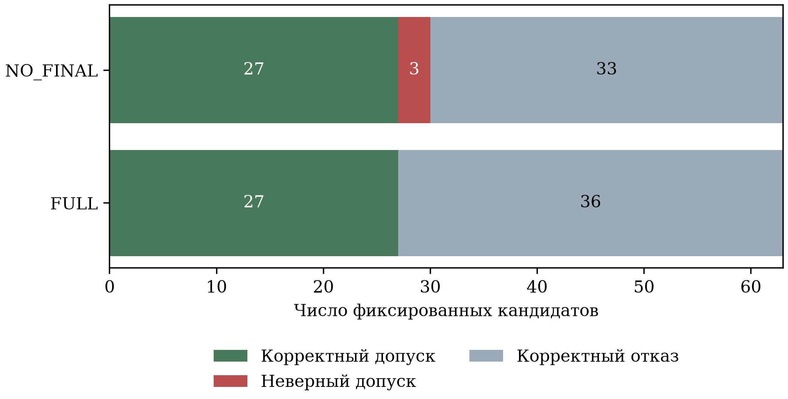
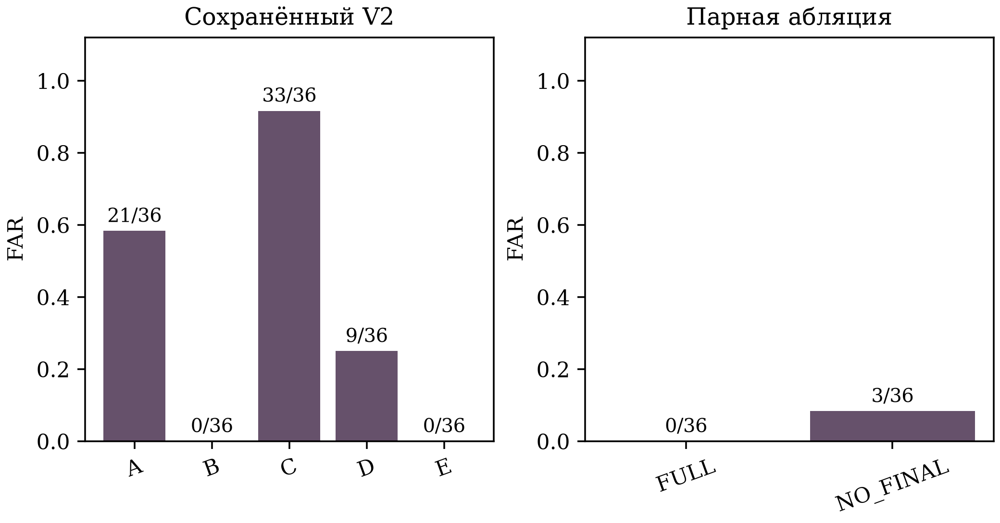

# Научно-технический отчёт MCP-Compat

## Аннотация

Исследуется допуск восстановленного вызова инструмента при эволюции контрактов Model Context Protocol. Предложен консервативный критерий, объединяющий структурную допустимость, независимое исполнение доверенных версий на копиях одного состояния, совместное сравнение результата и состояния, явно заданные предпосылки полноты наблюдений и повторную проверку контекстно привязанного свидетельства. Сформулированы условные свойства и контрпримеры универсальным гарантиям. Внешний набор включает три репозитория, восемь исторических переименований, четыре контроля сохранения поведения и 51 явно сконструированный случай. На 36 неприемлемых фиксированных кандидатах прежняя проверка допустила 21 ошибку, строгая — 0; обе сохранили 27 корректных кандидатов. Дополнительный парный опыт дал 126 решений и изолировал вклад финального допуска: 3/36 ложных допусков без него против 0/36 с ним. Эффект ограничен подготовленными отрицательными контролями. При трёх источниках p=0,25, статистическая значимость не установлена. Нулевой наблюдаемый риск не доказывает отсутствия ошибок в популяции. Представлены воспроизводимые данные, отрицательный результат V1, исправления реализации и ограничения переноса метода.

Отчёт объединяет формальную постановку, реализацию, первичные наблюдения и проверяемую методику оценки. Он подготовлен как самостоятельный документ для авторского и научного обсуждения; гарантии принятия в журнал или промышленной безопасности не даются.

## Оглавление

## Введение

Агент использует каталог инструментов, включающий имена и схемы параметров.
При обновлении сервера прежний вызов может перестать удовлетворять контракту.
Перенос аргумента или переименование инструмента способны восстановить
структурную допустимость, одновременно изменив прикладной результат. Например,
допустимый SQL-запрос с другим выражением возвращает другую величину; одинаковый
ответ об успехе не исключает изменения иной строки базы. Следовательно,
проверять следует основания допуска восстановленного вызова, включая состояние.

Генератор преобразования может быть правилом или языковой моделью. Его
уверенность не служит независимым подтверждением поведения. Исследовательский
вопрос: при каких явных предпосылках можно допустить конкретный кандидат и как
изменится соотношение корректных восстановлений, ошибочных допусков и отказов?
Оценка универсального качества языковых моделей за рамками основного опыта.

Сохраняются определения исторических метрик. Если R — число восстановимых сценариев, C — число корректных восстановлений, E — число EXECUTE, U — неверных EXECUTE, B — отказов на восстановимых сценариях, то

\[
CRR = C/R; UHR = U/E; FBR = B/R.
\]

При нулевом знаменателе значение не определено. Recoverable характеризует существование восстановления, а не правильность данного кандидата. Для одинаковых кандидатов дополнительно строится классификационная матрица TP/FP/TN/FN по их приемлемости. Отдельная метрика ложного допуска имеет общий знаменатель:

\[
FAR = FP/(FP+TN).
\]

Приемлемость устанавливается оценщиком по сохранённым полным пробам C из V2; структурно невалидный кандидат неприемлем без исполнения. Это оценочная переменная, не вход метода. Получены 27 приемлемых и 36 неприемлемых кандидатов. Три enum-кандидата неверны в восстановимых сценариях, поэтому знаменатели FAR и исторического FBR различаются. Принятие на MUST_ABSTAIN отдельно использует 33 случая политики отказа.

## Обзор научных исследований

Эволюция API, schema matching и сравнение программ имеют развитую предысторию
[1–4]. Differential testing выявляет несовпадение исполнений; совпадение может
сохранять общую ошибку. Regression verification ставит более сильные задачи
эквивалентности программ. Proof-carrying code использует доказательство политики
[5]; сохраняемая запись конечных проверок таким доказательством не является.

MCPEvol-Bench рассматривает работу агента при эволюции MCP-серверов [6]. Gecko
проверяет вызовы до исполнения с симуляцией и обратной связью [7]. ToolVerifier
использует модельную самопроверку [8]; ToolSandbox оценивает траектории через
состояния и ограничения milestones [9], а τ-bench — достижение конечного
состояния задачи [10]. JSONSchemaBench исследует структурную генерацию [11].
VerifierBench показывает необходимость испытывать сами проверяющие, включая
чрезмерные отказы [12]. MCP-Atlas использует реальные MCP-серверы [13].
ToolDriftBench исследует устаревание индекса инструментов [14]; для него доступна
проверенная аннотация и библиография, полный текст IEEE не получен. Приписывать
ему отсутствие семантических механизмов по одной аннотации нельзя.

**Научный вклад.** Сформулирован и реализован проверяемый критерий допуска
индивидуальной миграции MCP с разделением предложения, наблюдаемого сравнения,
предпосылок полноты, повторного допуска и закрытой оценки. Свидетель связывает
конкретные контракты, вызовы, состояние, реализации и профиль, а право допуска
требует пересчёта этих оснований. Представлены условные свойства и внешние
положительные/отрицательные контроли. Это специализация известных принципов
проверки для данной задачи, а не новый общий принцип доказательства или
установленное первенство в проверке инструментов.

Условие наблюдаемой замены связано с behavioral subtyping [18], которое сохраняет свойства спецификации при замене типа. Наш результат слабее: проверяется один вызов при конкретном состоянии. Отличие верификационной единицы и явной границы предпосылок не означает нового фундаментального принципа совместимости.

## Постановка задачи

Пусть \(C_{old},C_{new}\) — контракты инструмента, \(x\) — корректный старый
вызов, \(T(x)\) — предложенный новый вызов, \(S\) — начальное состояние,
\(F_{old},F_{new}\) — доверенные реализации. \(\pi_P\) выделяет результат и
компоненты состояния в заявленном профиле \(P\). Требуется определить решение \(A(C_{old},C_{new},x,T,E)\) со значениями EXECUTE или ABSTAIN, где \(E\) — доступные проверочные основания. Эталонная метка бенчмарка в \(E\)
не входит. Задача поиска правильного \(T\) отделена от проверки имеющегося.
Одинаковая схема совместима с реализациями разной семантики, поэтому из одной
структурной допустимости нужное решение в общем случае не выводится.

Проверяется решение для одного кандидата, а не возможность вывести семантику из описания API. Существование корректного преобразования и наличие правильного предоставленного кандидата различаются. При недоступности старой реализации, неизвестной паре версий или неконтролируемых внешних эффектах допускающих оснований недостаточно. Метод должен вернуть отказ и сохранить его причину.

Основной результат оценивается на сохранённых единичных вызовах. Это позволяет отделить качество предложенного преобразования от способности проверяющего обнаружить его ошибку. Для полного агента нужны дополнительные метрики поиска, планирования и покрытия траекторий; они не заменяются долей положительных исходов checker.

## Математическая модель

Пусть \(C_{old},C_{new}\) — контракты, \(x\) — корректный старый вызов, \(T(x)\) — заданный кандидат, \(S\) — начальное состояние. Доверенные реализации \(F_{old},F_{new}\) получают независимые копии одного состояния. Профиль \(P\) задаёт функцию наблюдения \(\pi_{P}\), которая включает результат и значимые компоненты состояния. Нормализация \(N\) сохраняет структуры/строки и приводит целочисленные числовые значения к общему представлению. Локальное условие наблюдаемой эквивалентности:

\[
N(\pi_{P}(F_{old}(x,S))) = N(\pi_{P}(F_{new}(T(x),S))).
\]

Это отношение для данного вызова и состояния, без квантора по всем программным входам. Обозначим через D(P) предоставленные оператором декларации полноты наблюдения, замкнутости эффектов, однозначности пары реализаций и детерминизма. Фактическая истинность этих предпосылок, P*, не выводится из JSON Schema или конечного числа проб. \(V_{x}\) означает валидность обоих входов, \(V_{y}\) — выходов по объявленным схемам; Q — повторяемость двух парных проб, H — равенство результата и состояния; \(V_{S}\) — привязку текущего состояния и успешный replay свидетельства.

\[
A = EXECUTE \iff D(P) \land V_{x} \land V_{y} \land Q \land H \land V_{S}.
\]

Иначе получается ABSTAIN. Без outputSchema проверяется лишь конечное сериализуемое JSON-наблюдение, и более слабый режим явно записывается. В полном Hybrid дополнительно обязательны полный поддерживаемый diff и допустимый адаптер: валидация сложной схемы не равна возможности безопасно мигрировать её изменение.

Из критерия следует отказ при отсутствующей обязательной декларации и структурная допустимость допущенного вызова. При истинном P*, корректном валидаторе, смыслосохраняющей N и независимых копиях S равенство H даёт указанное локальное отношение. Эталон отсутствует во входах допуска; это свойство границы данных, при предпосылке отсутствия скрытого канала в доверенном callback. Доказательства относятся к алгоритму, а не выводятся из тестового покрытия.

В версии admission-evidence-3 H и Q сравнивают непосредственно канонические байты наблюдений. Хеши сохраняются в свидетельстве для целостности; равенство хешей не подменяет равенства поведения. Для привязок контекста нужна криптографическая стойкость и доверенное происхождение исходного хеша, но подпись и подлинность обработчика из SHA-256 не следуют. Два совпавших повтора не доказывают детерминизм. После replay состояние ещё может измениться: перенос на реальный commit требует атомарности приложения.

## Разработанный метод

Алгоритм допуска включает последовательные границы доверия. Сначала фиксируются обе версии контракта, исходный вызов и кандидат. Структурная проверка не должна менять исходные данные; неизвестные преобразования в полном Hybrid остаются opaque. Затем проверяется наличие доверенных обработчиков и необходимых деклараций профиля. Отсутствие заявления о полноте не заменяется оптимистичным предположением.

Два парных исполнения получают независимые копии одного S. Для каждого сохраняются результат и конечное наблюдаемое состояние. Выход проверяется по собственной схеме, если она объявлена. Канонические нормализованные наблюдения сравниваются напрямую: Q требует совпадения повторных пар, H — old/new в каждой паре. Это конечная проверка при x,S, не доказательство поведения вне проведённых проб.

Успешный preview формирует версионированное свидетельство W. Оно включает хеши контрактов, старого и нового вызовов, начального состояния, идентификаторы обработчиков, профиль, версии нормализации и валидатора, результаты структурных проверок и хеши наблюдений. В W нет benchmark case_id, ground_truth или oracle. Запись passed не даёт постоянного права исполнения.

Перед окончательным допуском admit получает текущее состояние от доверенной стороны приложения. Он сверяет привязку состояния, повторяет вычисление проверки и сопоставляет полное свидетельство. Отсутствующая или изменённая запись отклоняется. При первоначальном ABSTAIN отказ сохраняется. Изменения кандидата, профиля, версии evidence или реализации требуют нового основания.

\[
W = (h(C_{old}), h(C_{new}), h(x), h(T(x)), h(S), I, P, \nu, V, Q, H).
\]

В версии 3 хеши наблюдений используются для контроля записи, а H/Q опираются на сами канонические наблюдения. Это различие позволяет сформулировать локальное свойство без логически неверного вывода из равенства произвольных digest. Привязки контекста всё ещё требуют криптографической предпосылки и доверенного происхождения хеша; пользователь должен знать эту границу.

Финальный шаг не удерживает транзакционную блокировку. Если реальная система меняет S после replay или во время него, требуется атомарная проверка версии при commit либо соответствующая транзакция. Свидетельство относится к определённому состоянию и доверенному коду; перенос на другой сервер или произвольный внешний эффект без повторной подготовки не обоснован.

## Формальные свойства и ограничения

**Утверждение 1 (отказ при отсутствующей декларации).** Если хотя бы одно
обязательное поле D(P) ложно, алгоритм возвращает ABSTAIN до проб.
Доказательство: отрицательная ветвь проверки конъюнкции предшествует вызовам.
Это не утверждение об обнаружении скрытой неполноты при ошибочно полном D(P).

**Утверждение 2 (структурная допустимость).** При EXECUTE старый и новый
вызовы удовлетворяют своим схемам и именам. Доказательство: оба validate_against
успешны до формирования положительного witness; исключение ведёт к отказу.
То же верно для выходов при объявленной outputSchema; без неё гарантируется
лишь сериализуемое конечное JSON-наблюдение в поддерживаемом профиле.

**Утверждение 3 (локальное равенство наблюдений).** При EXECUTE в новой версии
N(π(F_old(x,S))) и N(π(F_new(T(x),S))) равны для проведённых парных проб.
Доказательство: на каждой независимой копии S построены канонические байты;
Q проверяет повторяемость пар, H — равенство old/new в паре. Здесь не требуется
выводить равенство наблюдений из равенства их SHA-256.

**Утверждение 4 (перенос на заданную среду).** Если P* истинно, π выделяет
все значимые в данной задаче наблюдения и N сохраняет их смысл, то локальное
равенство сохраняет заданное наблюдаемое поведение при этом x,S.
Доказательство: полнота исключает существенную разницу вне π, детерминизм
исключает другой исход при том же входе и состоянии. Квантора по всем x,S нет.
Для последующего реального исполнения дополнительно нужны неизменные
реализации и атомарное сохранение состояния до commit. Реализация этого
условия относится к приложению и в общем случае здесь не предоставляется.

**Утверждение 5 (отделение эталона).** При соблюдении границы данных решение
функционально зависит от public inputs, trusted callbacks и D(P), а не от gold.
Доказательство: gold отсутствует в аргументах метода и впервые загружается
оценщиком после всех решений. Скрытые каналы произвольного callback исключены
предпосылкой доверия, а не доказаны одной сигнатурой Python.

**Утверждение 6 (неподдерживаемое преобразование).** Для полного Hybrid opaque
не превращается в разрешённую автоматическую миграцию после добавления checker.
Доказательство: отказ SchemaDiffEngine/Hybrid предшествует допуску. Независимая
проверка предоставленного человеком кандидата исследуется отдельно и не
снимает ограничений генератора.

### Контрпримеры универсальным утверждениям

Одинаковые входные схемы совместимы с F_old(x)=x и F_new(x)=x+1: валидность
схемы не доказывает сохранения смысла. Если π исключает запись в журнал,
обработчики могут вернуть одинаковый ответ, изменив разные журналы: равенство
π не доказывает равенство полного поведения при ложном P*. Если обработчик
возвращает один ответ на конечном числе проб, а затем другой, никакое такое
число проб не доказывает детерминизм. Если S меняется после последнего replay,
положительный witness не гарантирует поведение последующего commit. Наконец,
две версии могут одинаково нарушать предметную спецификацию: эквивалентность
не доказывает правильность самой старой реализации. Прохождение тестов не
подменяет ни одно из перечисленных доказательств и предпосылок.

## Архитектура реализации

Ядро состоит из моделей контрактов и вызовов, валидатора JSON Schema, консервативного diff, ограниченного языка преобразований и Hybrid. Поиск кандидата отделён от проверки; генератор может быть правилом или внешним агентом через LLMClient. Для исторических опытов использовались GigaCode CodeAgent и отдельная конфигурация Terra, но новый эксперимент не обращается к модели.

EvidenceVerifier реализует тот же интерфейс RuntimeVerifier и расширяет существующее поле Verification.evidence. ObservationProfile содержит перечисление компонентов состояния и декларации complete, closed_environment, deterministic, unambiguous; значения по умолчанию ложны. Обработчики связываются с хешами контрактов и идентификаторами реализации. Начальное состояние копируется при регистрации и отдельно для каждой пробы. При ошибке входа, выхода, неизвестном состоянии, различии повторов, несовпадении поведения или превышении измеренного времени получается отказ.

Верификатор не является средством выполнения произвольного чужого кода. Таймаут callback проверяется после его возврата; принудительное ограничение процесса и OS-изоляция реализованы внешним стендом. Доверие к идентификатору обработчика и отсутствие скрытых эффектов входят в модель среды. Нельзя превращать метод в безопасный execution gateway одним только подключением функции Python.

Новый SDK2-слой расположен отдельно от исторического SDK1. Приложение передаёт вместе admission и доверенный поставщик current_state. После восстановления вызывается общий admit; stale state и отсутствующий witness отклоняются. Параметры подтверждения не берутся у модели. Обычный proxy без этих параметров остаётся транспортом исследования заданной стратегии.

Загрузчик external.py проверяет digest манифеста, public/provenance и хеши vendored sources; не открывает gold.json, отвергает подмену файлов, выход пути за корень и лишний контекст. Метки доступны только оценщику. Source loader и evaluator тем самым имеют разные обязанности: первый проверяет допустимые входы метода, второй сопоставляет решения с явно записанным ручным эталоном.

Runner сохраняет отдельно решение, время, число source-вызовов, нативный ответ сервера, полное наблюдение после вмешательства и частичное наблюдение verifier. После всех решений читается gold. Сохраняются result-digests, artifact-digests, summary и runtime-accounting. Завершённый resume проверяет хеши/полную матрицу и ничего не исполняет. Физические business-вызовы считаются отдельно от initialize/list и не выдаются за число независимых сценариев.

Сохранены SchemaDiffEngine, ограниченный язык операций миграции, Hybrid и
исторический SandboxVerifier. EvidenceVerifier версии 3 использует существующий
тип Verification.evidence; второго формата решений не вводится. Алгоритм:
получить кандидат → проверить привязку/профиль и входы → сравнить два независимых
парных исполнения с выходными схемами → записать preview → применить admit с
текущим состоянием и replay → допустить либо отказать. Доверенный callback
сам по себе не изолирует чужой код; внешний стенд использует отдельную OS-политику.

Минимальный профиль MCP 2026-07-28 выполнен отдельно на официальном SDK 2.3.0;
историческое окружение SDK 1.30.0 сохранено. Проверены meta/version/capabilities,
stateless tools/list/call без обязательного initialize, output schema, объект
и массив structuredContent, ошибки, отрицательные raw JSON-RPC и два направления
stdio взаимодействия SDK. Составные JSON Schema валидируются, а неподдерживаемая
миграция остаётся opaque. Streamable HTTP, routing headers, авторизация,
MRTR и расширения не проверены; полная поддержка редакции не заявляется [16].

## Методика экспериментов

Внешние реализации не создавались для этого исследования. Зафиксированы MIT-
исходники и лицензии следующих пар:

Таблица — Внешние реализации и исторические изменения

| Источник | Старый → новый commit (полные SHA в provenance) | Историческая часть |
|---|---|---|
| modelcontextprotocol/servers, Filesystem | 5a48c0bf → 11a064c3 | 4 чтения, read_file → read_text_file |
| modelcontextprotocol/servers-archived, SQLite | 25d1a1c2 → acc3ba27 | 2 SELECT и 2 UPDATE/DELETE, смена имён |
| githejie/mcp-server-calculator | 5b828b92 → a07908b4 | 4 арифметических контроля после добавления math |

По каждому источнику добавлено 17 явно сконструированных вмешательств, в том
числе смена смысла при допустимой схеме, скрытое состояние, внешний ресурс,
изменение default/единиц, потеря информации, required без значения, opaque,
неоднозначность, меняющиеся исходы и TOCTOU. Обёртка накладывает вмешательство
после **реального ответа** сервера. Эти случаи не выдаются за исторические
дефекты внешних проектов. Всего 63 случая, из них 30 восстановимых и 33 с
требуемым отказом. Четыре benign Calculator вынесены в CONTROL; исходный
технический family=C1 в замороженных данных не переписан.

Gold явно подготовлен по коду и тестовым состояниям до оценивания, хранится
отдельно и не читается загрузчиком входов. Кандидаты A–E зафиксированы заранее,
не генерируются моделью. Оценщик после всех решений проверяет старую реализацию
по ручному эталону и каждый EXECUTE двумя новыми пробами. Второго независимого
разметчика не было. Полнота/замкнутость/однозначность профиля — ручные декларации,
а не результат автоматического обнаружения опасности. Правила в context пусты.

Сравниваются A — прежняя проверка; B — строгая с final admission; C — только
новая input schema; D — B с принудительно подтверждёнными предпосылками; E —
запрет доверять полноте. Отдельно запускается настоящий M1_old/M1_new без mapper:
identity/ранний отказ возможны, поэтому их нельзя считать тем же кандидатом A–E.
Основной дополнительный V2 заморожен коммитом 1dcaffe3 до выполнения.

Каждый реальный stdio сервер работает в отдельном macOS sandbox с вымышленными
файлами/строками базы. Сеть и доступ к пользовательским данным запрещены;
отрицательные пробы чтения, записи и соединения завершились PermissionError.
Это профиль для просмотренного кода и фиксированных входов, не гарантия для
произвольного враждебного сервера. Python 3.11.4, macOS arm64, Apple M4;
SDK 1.30.0 для Python и 1.12.3 для Filesystem, Node 26.9.0. Зависимости закреплены.

### Изоляция внешнего кода

`external_runtime.py` запускает процесс Python, а из него реальный сервер
stdio, внутри macOS sandbox. HOME, TMPDIR и разрешённые записи ограничены
одноразовой `/private/tmp/mcp-external-*`. Для SQL создаётся отдельная база с
двумя вымышленными строками; для Filesystem — два вымышленных файла. Сеть
запрещена; токены/пользовательские настройки в environment не передаются.
Имена файлов плоские. Исполняемые выражения/SQL фиксированы в наборе.

Отрицательные пробы **получили PermissionError errno 1** при чтении `.git/HEAD`,
записи вне test directory и соединении с localhost. Машинное свидетельство:
`validation/publication-isolation.json`. Сначала пробы не проходили из-за
недостаточных системных прав; чужой код до рабочей политики не выполнялся.

Это ограниченный профиль для просмотренных исходников и конечных тестовых
входов. Таймаут процесса — дополнительная граница, не доказательство изоляции
произвольного враждебного кода. На другой OS необходима эквивалентная проверенная
изоляция; если её нет, исполнения NOT RUN, и контрактная проверка не считается
семантическим экспериментом.

## Результаты V1/V2

Получены 441 решение и 1453 попытки business tool-вызова без ошибок источников.
Модельных запросов в новом опыте нет. Полный аудит матрицы, SHA-256 и независимый
пересчёт семантических оценок по evaluator-трассам прошли.

Таблица — Основные показатели внешнего опыта V2

| Метод | CRR | UHR | FBR | Отказ из 33 |
|---|---:|---:|---:|---:|
| A | 27/30 | 21/48 | 2/30 | 13/33 |
| B | 27/30 | 0/27 | 3/30 | 33/33 |
| C | 27/30 | 33/60 | 0/30 | 3/33 |
| D | 27/30 | 9/36 | 3/30 | 24/33 |
| E | 0/30 | N/A | 30/30 | 33/33 |
| M1_old | 14/30 | 15/29 | 16/30 | 18/33 |
| M1_new | 14/30 | 0/14 | 16/30 | 33/33 |

B не увеличивает число корректных восстановлений; он отклоняет неверные
допуски A в подготовленном наборе. У C входная схема не обнаруживает 33
семантических расхождения. D допускает 9 ошибок частичного наблюдения;
декларации полноты нельзя заменять молчаливым предположением. E отклоняет
всё: UHR неопределён, поэтому «нет ошибок» без покрытия не является успехом.
FBR B включает отказ от неверного enum-кандидата в восстановимом случае.

Таблица — Историческая и сконструированная части, поддержка и побочные эффекты

| Часть | A: CRR; UHR | B: CRR; UHR | M1_old → M1_new: CRR; UHR |
|---|---|---|---|
| Историческая, 12 | 12/12; 0/12 | 12/12; 0/12 | 8/12 → 8/12; 0/8 → 0/8 |
| Сконструированная, 51 | 15/18; 21/36 | 15/18; 0/15 | 6/18 → 6/18; 15/21 → 0/6 |
| Поддерживаемый diff, 37 | 13/15; 16/29 | 13/15; 0/13 | 14/15 → 14/15; 15/29 → 0/14 |
| Реальные UPDATE/DELETE, 2 | 2/2; 0/2 | 2/2; 0/2 | 2/2 → 2/2; 0/2 → 0/2 |

Эффект по ложным допускам установлен на искусственных отрицательных контролях,
а не на исторических отрицательных миграциях. Все 12 исторических случаев
положительные; на них A/B/C/D одинаковы. Полный Hybrid не восстанавливает
Filesystem из-за opaque, хотя предоставленный ручной кандидат проверяется B.
27/30 B нельзя выдавать за качество генерации полного M1 или модели.

B получает 9/10 CRR и 0/9 UHR в каждом источнике. У A UHR: Filesystem 5/14,
SQLite 11/20, Calculator 5/14. У M1_new CRR соответственно 0/10, 7/10, 7/10;
нулевой UHR не устраняет цену отказа. Детализация C1–C8, CONTROL, всех шести
долей, источников и побочных эффектов опубликована в EXTERNAL_EXPERIMENT_RESULTS.md
и машинном CSV; график external-rates.png построен скриптом external_results.py.

Первый прогон V1 намеренно сохранён: 441 решение, 1158 вызовов. M1_new имел
1/16 UHR и два допуска TOCTOU-контролей: вызывающая сторона пропустила final
admission. V2 исправляет caller и усиливает наблюдаемое изменение TOCTOU fixture,
не меняя public/gold. Это дополнительный анализ после обнаруженной ошибки,
не слепое подтверждение на новом наборе. Причинный эффект одного патча из
межверсионной разности не выводится.

Прежние модельные исследования сохраняются отдельно и не объединяются с новым внешним набором. Данный опыт оценивает допуск фиксированного кандидата, не качество генерации модели.

## Дополнительные экспериментальные результаты

Проведён отдельный парный опыт final-admission-ablation-1: 63 случая × 2 варианта = 126 решений и 666 попыток вызова внешнего инструмента; ошибок источников 0. Исходники зафиксированы до опыта коммитом 8f11d69bc. FULL применяет preview и final admit, NO_FINAL пропускает только final admit. Один runtime, те же кандидаты, профили и TOCTOU-состояния; эталон открыт после всех решений. Модельных запросов нет.

FULL сохранил 27 корректных восстановлений и отклонил все 36 неприемлемых кандидатов. NO_FINAL сохранил те же 27, но принял три неверных TOCTOU-кандидата — по одному на источник. Исторические CRR равны 27/30; UHR равен соответственно 0/27 и 3/30; FBR у обоих 3/30. На общем отрицательном множестве FAR составляет 0/36 и 3/36. Разность FULL−NO_FINAL равна −0,0833. Ни одного расхождения принятия на остальных 60 случаях не обнаружено.

Этот опыт устраняет смешение двух изменений V1–V2 для вопроса о final admission. Он остаётся проверкой известного сконструированного контроля, без нового holdout. FULL — полный критерий допуска предоставленного кандидата; это обозначение не относится к полному гибриду M1 без mapper. Полный M1 имеет самостоятельные ограничения поиска преобразования и другое покрытие.

Для решений FULL выполнено 300 source-вызовов, для NO_FINAL — 192; остальные 174 относятся к оценке. Медианы задержки 1,673 и 1,596 с, p95 — 3,533 и 1,829 с. Измерено время решения с запуском процессов; порядок фиксирован, поэтому причинный вывод о скорости не делается. Суммарное время решений 115,58 и 73,94 с не включает последующий evaluator и не является оценкой трудоёмкости внедрения.

Таблица — Матрицы на общих фиксированных кандидатах

| Метод | TP | FP | FN | TN | FAR |
|---|---:|---:|---:|---:|---:|
| A, V2 | 27 | 21 | 0 | 15 | 21/36 |
| B, V2 | 27 | 0 | 0 | 36 | 0/36 |
| C, V2 | 27 | 33 | 0 | 3 | 33/36 |
| D, V2 | 27 | 9 | 0 | 27 | 9/36 |
| E, V2 | 0 | 0 | 27 | 36 | 0/36 |
| FULL, новый | 27 | 0 | 0 | 36 | 0/36 |
| NO_FINAL, новый | 27 | 3 | 0 | 33 | 3/36 |

## Статистический анализ

Повторные сценарии одного инструмента зависимы; кластером выбран источник [17].
Выполнены парный bootstrap по трём репозиториям (2000 выборок, seed=42),
точная перестановка меток методов целыми кластерами, объединение двух
официальных источников в lineage и исключение каждого источника.

Таблица — Парные кластерные оценки разностей исторических метрик

| Контраст | Δ CRR | Δ UHR | 95% bootstrap Δ UHR | p (3 / 2 кластера) |
|---|---:|---:|---|---|
| B−A | 0 | −0,4375 | [−0,55; −0,3571] | 0,25 / 0,5 |
| B−C | 0 | −0,55 | [−0,55; −0,55] | 0,25 / 0,5 |
| B−D | 0 | −0,25 | [−0,25; −0,25] | 0,25 / 0,5 |
| M1_new−M1_old | 0 | −0,5172 | Не определён (75/2000 resamples) | 0,5 / 0,5 |

При lineage для полного M1 интервал [−0,5882; −0,4167]. Неопределённые выборки
без EXECUTE не исключались ради более удобного интервала. При исключении
FS/SQLite/Calculator ΔUHR B−A равна −0,4706/−0,3571/−0,4706; B−D сохраняется
−0,25. ΔFBR B−A = +0,0333, 95% [0;0,1], p=1. ΔCRR всех пар 0, p=1.

**Статистически значимое превосходство не установлено.** При двух–трёх кластерах
p дискретны, percentile bootstrap может вырождаться из-за одинаковых шаблонов.
Он не обращает точный перестановочный тест; исключение нуля в одном интервале
не отменяет незначимый p. Обменность меток и iid источников не обеспечены
случайным выбором; сравнения разведочные, без подтверждающего семейства гипотез.

При нуле ошибок обычный bootstrap даёт [0;0], что не является убедительной
границей риска. Рассмотрено событие «хотя бы один неверный допуск в исполняющем
источнике». При iid источниках его односторонняя 95%-я граница для k=0 есть
\(1-0{,}05^{1/n}\): 0,6316 для B при n=3, 0,7764 для M1_new при n=2.
После объединения lineage для B — 0,7764. Это **не граница per-call UHR**.
При фактическом целевом выборе источников iid не установлена; без популяционной
модели нет нетривиальной верхней гарантии UHR, остаётся 1.

### Матрицы общих кандидатов

Сохраняются определения исторических метрик. Если R — число восстановимых сценариев, C — число корректных восстановлений, E — число EXECUTE, U — неверных EXECUTE, B — отказов на восстановимых сценариях, то

\[
CRR = C/R; UHR = U/E; FBR = B/R.
\]

При нулевом знаменателе значение не определено. Recoverable характеризует существование восстановления, а не правильность данного кандидата. Для одинаковых кандидатов дополнительно строится классификационная матрица TP/FP/TN/FN по их приемлемости. Отдельная метрика ложного допуска имеет общий знаменатель:

\[
FAR = FP/(FP+TN).
\]

Приемлемость устанавливается оценщиком по сохранённым полным пробам C из V2; структурно невалидный кандидат неприемлем без исполнения. Это оценочная переменная, не вход метода. Получены 27 приемлемых и 36 неприемлемых кандидатов. Три enum-кандидата неверны в восстановимых сценариях, поэтому знаменатели FAR и исторического FBR различаются. Принятие на MUST_ABSTAIN отдельно использует 33 случая политики отказа.

Для FAR B−A разность −0,5833, 95%-й кластерный bootstrap [−0,9167; −0,4167], p=0,25 по трём источникам и p=0,5 по двум lineage. Для B−C разность −0,9167, для B−D −0,25; соответствующие интервалы вырождены из-за одинаковых шаблонов источников, p=0,25. FULL−NO_FINAL даёт −0,0833, интервал [−0,0833; −0,0833], p=0,25; после объединения lineage p=0,5. Вырожденный интервал не доказывает отсутствия неопределённости.

Парные матрицы на 36 неприемлемых кандидатах показывают 21 принятие только A при сравнении B/A, 33 только C для B/C, 9 только D для B/D и 3 только NO_FINAL для FULL/NO_FINAL. Принятий только строгим вариантом нет. Эти согласованные пары не трактуются как 36 независимых репозиториев. Исключение одного источника сохраняет направление точечного эффекта, но оставляет лишь два кластера.

Перестановочные выводы условны по обменности меток методов внутри целых кластеров. Источники выбраны целевым образом, а отрицательные шаблоны повторяются, поэтому iid и обменность не обеспечены случайным дизайном. Уровень значимости не достигнут, корректировка условий ради получения значимого p не проводилась.

## Анализ ошибок

Первый внешний V1 выявил ошибку вызывающей стороны: положительный preview полного M1 передавался дальше без общего final admission. В результате были приняты два TOCTOU-контроля, один из которых дал фактическое расхождение наблюдений. UHR составил 1/16. Два других тестовых источника меняли лишь marker, не отражённый в files/rows: нарушение политики MUST_ABSTAIN и семантическая ошибка не совпадают автоматически.

V2 добавил final admit и усилил TOCTOU fixture фактической сменой файлов/строк. Исправление было необходимо, но V1–V2 не изолировали один компонент. Новый опыт FULL/NO_FINAL устранил именно это смешение: обе ветви получают один runtime и одинаковые изменённые состояния. Он подтвердил три расхождения на подготовленных TOCTOU-кандидатах без иных изменений решений.

Заключительный аудит обнаружил и математическую неточность версии 2: H/Q сравнивались по digest, тогда как текст определял равенство нормализованных наблюдений. Регрессионный тест искусственно подменяет digest функцией с одинаковым результатом. До исправления различное поведение ошибочно признавалось равным, после — отклоняется. Это не сообщение о найденной практической коллизии SHA-256: устранена лишняя логическая предпосылка поведенческого сравнения. Обычные результаты V1/V2 не переписывались.

Отдельно сохраняются невыгодные свойства метода. Полный Hybrid без mapper не восстанавливает Filesystem при opaque diff. Предоставленный вручную кандидат может пройти отдельную проверку, но это не означает улучшения генератора. Всеобщее отключение доверия к полноте E даёт 27 ложных отказов на 27 приемлемых кандидатах и неопределённый UHR, поскольку исполнений нет. Такая стратегия не может объявляться успешной только по отсутствию неверных исполнений.

## Научная новизна

Самостоятельный результат работы формулируется как конкретный метод консервативного допуска индивидуальной MCP-миграции с перечисленными проверяемыми и доверенными предпосылками, joint result/state relation и воспроизводимым свидетельством. Генерация, проверка схем, наблюдаемое сравнение, final admission и независимый evaluator разделены так, что основание каждого решения можно повторить без эталонной метки.

Differential testing, snapshots, консервативный отказ, проверка состояния и идея проверочного свидетельства имеют предшественников. Их объединение само по себе не является новым фундаментальным алгоритмом. Отличие здесь — выбранная единица MCP-миграции, явное разграничение D(P)/P*, контекстная применимость свидетельства и исследовательский протокол, измеряющий ложные допуски вместе с отказами.

Эмпирическая часть показывает локальные вклады сравнения результата и состояния, деклараций полноты и final admission на фиксированных кандидатах. Полнота профиля не выводится автоматически, поэтому снижение ошибок на скрытых эффектах нельзя приписывать обнаружению неизвестной опасности. Мы не утверждаем, что повторяющий известные принципы код сам по себе доказывает научную новизну. Вывод о достаточности вклада для конкретного журнала остаётся предметом авторской и редакционной оценки.

## Практическая значимость

Практическая область — контролируемая миграция вызовов, где доступны обе доверенные версии, воспроизводимое состояние и предметный профиль наблюдения. Свидетель позволяет проверить, какое именно преобразование и при каких предпосылках допускалось. Если среда или реализация изменились, требуется новая проверка, а не перенос старого положительного флага.

Случаи чтения файлов демонстрируют переименование инструмента без потери параметров head/tail. SQLite показывает необходимость наблюдать и возвращённые строки/affected_rows, и конечную базу. Calculator даёт контроли сохранения арифметики. Эти примеры не моделируют продукционную нагрузку или пользовательские данные; все состояния вымышленные и изолированные.

Прототип полезен и как исследовательский инструмент: один сохранённый кандидат допускает сравнение разных проверок без новых модельных запросов. Общая FAR-матрица показывает ошибки на одном отрицательном множестве, а исторические CRR/UHR/FBR сохраняют совместимость с прежними опытами. При наличии готового достоверного правила ручная миграция может оказаться дешевле подготовки двух trusted runtimes. Затраты на экспертное задание полноты и gold в часах не измерялись, поэтому общая экономическая эффективность не установлена.

## Ограничения исследования

Исследованы три целево выбранных репозитория, причём два имеют общее
происхождение. 51 вариант разделяет 17 шаблонов; число решений не равно
числу независимых наблюдений. Историческая отрицательная часть недостаточна.
Дополнительная найденная смена move_file исключена: новая реализация исправляла
старое нарушение документации, а сохранение перезаписи поддерживало бы ошибку.
Наблюдаемая эквивалентность не доказывает правильность исходной спецификации.

Ручные кандидаты, профили и эталоны ограничивают независимость дизайна; второго
разметчика нет. Каталоги исторического кода получены на закреплённом текущем
SDK, а не сохранены в день исходного commit. Wrapper-эффекты явно отделены
от нативных ответов, не характеризуют дефекты внешних проектов. Методы A–E
не оценивают поиск кандидатов. M1 без mapper имеет 16/30 ложных отказов;
необоснованно объявлять полный гибрид практически предпочтительным.

Профиль не выводит полноту из схемы, не охватывает неконтролируемые сетевые
эффекты. Таймаут после callback не изолирует чужой код. OS-стенд проверен для
конкретных просмотренных серверов. Replay не гарантирует атомарность remote
commit, а два совпавших повтора — детерминизм. Криптографическая подпись и
доказательство эквивалентности программ не предоставляются. Минимальный
профиль MCP не включает HTTP/auth/MRTR. Исследование не является production-
экспериментом, репликацией внешней лаборатории или оценкой популяционного риска.

V2 проведён после анализа V1, поэтому нужен последующий нетронутый набор.
Исторические модельные опыты включают разные CLI и бюджеты повторов; мировой
приоритет и устойчивое преимущество Terra не установлены. Отсутствие измерения
человеко-часов не позволяет оценить полную экономическую эффективность.

Дополнительный поиск не дал достаточно подтверждённых отрицательных исторических пар для расширения основного набора. Обсуждение annotations или отдельный issue без закреплённых исходников и независимого gold недостаточны. Исправление старого нарушения спецификации не должно превращаться в требование сохранить ошибочное поведение. Набор не увеличивался искусственно ради размера или статистической значимости.

## Заключение

Разработан и испытан консервативный критерий допуска отдельной MCP-миграции на основе явно заданного профиля наблюдений, совместной проверки результата и состояния и воспроизводимого свидетельства. Прямая проверка наблюдений согласована с формальной моделью, а финальный replay привязывает решение к текущему состоянию при сохраняющейся границе atomic commit.

На подготовленном наборе строгая проверка сохранила 27 корректных кандидатов при 0 неверных допусков; прежняя имела 21 неверный допуск. Дополнительная парная абляция установила локальный вклад final admission: он отклонил три ошибочных допуска после смены состояния без потери корректных восстановлений. Эффект наблюдался на сконструированных отрицательных контролях. При трёх источниках статистическая значимость и универсальная безопасность не установлены. Практический результат — проверяемые основания индивидуального допуска и явное измерение цены отказа; следующий шаг — нетронутые исторические семантические изменения, независимая разметка и оценка стоимости профиля.

## Литература

1. Rahm E., Bernstein P. A. A survey of approaches to automatic schema matching.
The VLDB Journal. 2001. Т. 10. С. 334–350. DOI:
[10.1007/s007780100057](https://doi.org/10.1007/s007780100057).
2. Dig D., Johnson R. How do APIs evolve? A story of refactoring. 2006.
DOI: [10.1002/smr.328](https://doi.org/10.1002/smr.328).
3. McKeeman W. M. Differential Testing for Software. Digital Technical Journal.
1998. Т. 10, № 1. С. 100–107.
[Первичный текст](https://www.cs.tufts.edu/comp/150FP/archive/bill-mckeeman/DifferentailTesting.pdf).
4. Godlin B., Strichman O. Regression verification. DAC. 2009.
DOI: [10.1145/1629911.1630034](https://doi.org/10.1145/1629911.1630034).
5. Necula G. C. Proof-carrying code. POPL. 1997.
DOI: [10.1145/263699.263712](https://doi.org/10.1145/263699.263712).
6. Liu H., Hu K., Liao J. и др. MCPEvol-Bench: Benchmarking LLM Agent Performance
Across Dynamic Evolutions of MCP Servers. 2026. arXiv:2607.14642v1.
[Первичный текст](https://arxiv.org/html/2607.14642v1).
7. Zhang Z., Li G., Xing Z., Apostolopoulos A., Lee Y. L., Zheng L.
Gecko: A Simulation Environment with Stateful Feedback for Refining Agent Tool
Calls. 2026. arXiv:2602.19218v2. [Текст](https://arxiv.org/html/2602.19218v2).
8. Mekala D., Weston J. E., Lanchantin J. и др. TOOLVERIFIER: Generalization to New Tools via Self-Verification. Findings of EMNLP. 2024. С. 5026–5041. DOI: [10.18653/v1/2024.findings-emnlp.289](https://aclanthology.org/2024.findings-emnlp.289/).
9. Lu J., Holleis T., Zhang Y. и др. ToolSandbox: A Stateful, Conversational,
Interactive Evaluation Benchmark for LLM Tool Use Capabilities. 2025.
arXiv:2408.04682v2. [Текст](https://arxiv.org/html/2408.04682v2).
10. Yao S., Shinn N., Razavi P., Narasimhan K. τ-bench: A Benchmark for
Tool-Agent-User Interaction in Real-World Domains. 2024. arXiv:2406.12045v1.
[Текст](https://arxiv.org/html/2406.12045v1).
11. Geng S., Cooper H., Moskal M. и др. JSONSchemaBench: A Rigorous Benchmark of
Structured Outputs for Language Models. 2025. arXiv:2501.10868v3.
[Текст](https://arxiv.org/html/2501.10868v3).
12. Yin J., Chen Z., Wang H. и др. VerifierBench: Benchmarking the Generation of
Executable Verifiers for LLM Agents. 2026. arXiv:2610.28679v1.
[Текст](https://arxiv.org/html/2610.28679v1).
13. Bandi C., Dumitru R.-G., Hertzberg B. и др. MCP-Atlas: A Large-Scale Benchmark
for Tool-Use Competency with Real MCP Servers. 2026. arXiv:2602.00933v3.
[Текст](https://arxiv.org/html/2602.00933v3).
14. Paidi S. K., Bonagiri V. R. K. ToolDriftBench: Detecting and Recovering
from MCP Tool Index Staleness in Agentic Systems. IEEE SmartIoT. 2026.
DOI: [10.1109/SmartIoT70864.2026.00056](https://doi.org/10.1109/SmartIoT70864.2026.00056).
[Метаданные издателя в Crossref](https://api.crossref.org/works/10.1109/SmartIoT70864.2026.00056).
15. Li R., Wang H., Zhang Y., Zhang W. Correspondences as Decisions: JevNexus for
Decision-Centric Schema Matching. 2026. arXiv:2610.09487v1.
[Первичная страница](https://arxiv.org/abs/2610.09487).
16. Model Context Protocol. Specification 2026-07-28.
[Официальная спецификация](https://modelcontextprotocol.io/specification/2026-07-28).
17. Cameron A. C., Miller D. L. A Practitioner's Guide to Cluster-Robust Inference.
Journal of Human Resources. 2015. Т. 50, № 2. С. 317–373.
[Авторская версия](https://cameron.econ.ucdavis.edu/research/Cameron_Miller_JHR_2015_February.pdf).
18. Liskov B. H., Wing J. M. A Behavioral Notion of Subtyping. ACM Transactions on Programming Languages and Systems. 1994. Т. 16, № 6. С. 1811–1841. [Авторский текст](https://www.cs.cmu.edu/~wing/publications/LiskovWing94.pdf).

## Приложения

### Версии и повторный анализ

Основные frozen наборы и V1/V2 сохраняются побайтово. Внешний набор имеет digest 6ab2bfb7da1687012c70a8acac5254f571381af8cd03d0911d393ba41e010b8f. Дополнительный опыт хранится отдельно как final-admission-ablation-2026-11-05, анализ — final-comparison-2026-11-05. Его исходники зафиксированы до первого вызова, source_digest включает дополнительный runner. CSV candidate-decisions содержит 63 строки с источником, типом, вмешательством, приемлемостью и решениями семи вариантов.

Проверка старых трасс выполняется external_results.audit; общие знаменатели и новые контрасты — admission_comparison.py. Эти процедуры читают данные и ничего не вызывают у моделей/серверов. Для нового анализа нужен новый выходной каталог. Старый завершённый эксперимент следует читать его закреплённым snapshot-кодом, поскольку новые версии доказательства/источников меняют fingerprint.

### Граничные проверки

Тесты покрывают структурно допустимый вызов с неверным смыслом; одинаковый результат при разном состоянии; скрытый эффект при неполном профиле; зависимость от внешнего ресурса; меняющиеся повторы; потерю информации; смену единиц; неизвестный required; default; неоднозначную привязку; opaque схемы; смену состояния между проверками; отсутствие/подмену свидетельства; не-JSON/NaN; искусственную коллизию digest. По каждому случаю различаются исполнение доверенного callback и изоляция чужого source-процесса.

Положительные контроли столь же обязательны: стратегия E ничего не исполняет и поэтому не имеет определённого UHR. Новое сравнение не удаляет неверные ответы, неопределённые bootstrap-выборки или провайдерные ошибки исторических опытов. Корректность old gold проверяется отдельно от допуска и не подгоняется под вердикт метода.

### Инженерная проверка

Новая версия прошла 379 тестов с 8 пропусками в основном окружении. Покрытие исходного пакета по statements и branches составляет 100%; примерные и документные скрипты не включаются автоматически в этот процент. Семь opt-in провайдерных смоков не запускались; отдельный SDK2 каталог пропускается в SDK1 окружении и проверяется отдельно — 10 тестов без пропусков. Новых платных операций не выполнялось.

Итоговая сборка wheel, чистая установка, offline E2E, хеши исторических файлов, структурные проверки DOCX и визуальный контроль фиксируются отдельным финальным манифестом выпуска. Прохождение тестов не подменяет условных математических доказательств и не гарантирует принятия статьи редакцией.

### Авторские сведения

Автор: Россинский Андрей Евгеньевич, Франкфурт, dennrbone@gmail.com. Организация и редакционные декларации не предоставлены; они не выдумываются. Конкретный журнал не выбран, его правила и статус не проверены. Обязанности раскрытия использования ИИ, финансирования и конфликтов интересов определяются выбранной редакцией и требуют авторской проверки. Научная специальность 2.3.5 соответствует предмету алгоритмов, программного обеспечения и совместимости вычислительных систем; это тематическое соответствие, не заключение ВАК.
